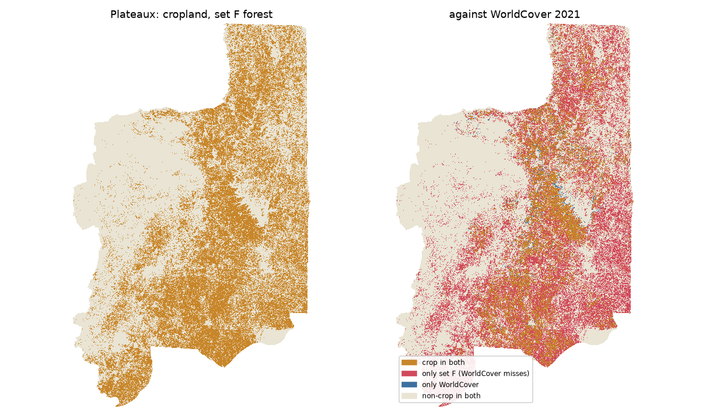

# Season vs embeddings: mapping smallholder farms in Togo

Can a pretrained Earth embedding identify smallholder farmland more reliably than a full growing season of
satellite imagery? This repository holds the code and the saved results of my GIMA Module 1 project
(Programming and Machine Learning, 2026), a case study of Togo in 2019.

- Poster: [`docs/poster.pdf`](docs/poster.pdf)
- Pitch video: _link follows_
- Walkthrough: [`notebooks/walkthrough.ipynb`](notebooks/walkthrough.ipynb) covers the whole workflow and runs in
  about a minute on the data in this repository.

## Results in short

One Random Forest separates crop from other land for six inputs, from a single Sentinel-2 image to three
foundation-model embeddings. Tuning folds are grouped by 5 km cell, and every model predicts 306 random,
three-person-labelled test points once.

| Input | F1 crop | OA | UA crop | PA crop |
|---|---|---|---|---|
| A one Sentinel-2 image | 0.66 | 0.73 | 0.59 | 0.75 |
| B full season (Sentinel-2, 68 statistics) | 0.75 | 0.81 | 0.68 | 0.83 |
| C season + Sentinel-1 radar | 0.75 | 0.81 | 0.68 | 0.84 |
| D AlphaEarth embedding | 0.76 | 0.82 | 0.70 | 0.83 |
| E TESSERA embedding | 0.73 | 0.80 | 0.69 | 0.78 |
| F OlmoEarth embedding | 0.81 | 0.86 | 0.79 | 0.82 |
| ESA WorldCover 2021 | 0.70 | 0.83 | 0.87 | 0.58 |
| Digital Earth Africa crop mask 2019 | 0.71 | 0.81 | 0.75 | 0.67 |

OlmoEarth scored highest. Against the full season the exact McNemar test gives p = 0.03, or 0.10 after correcting
for three embeddings, so the gain is not significant after correction. Its main gain is fewer false alarms, 23
against 41.
WorldCover raises only 9 but misses 44 crop points against OlmoEarth's 19, and the gap between the two is not
significant (p = 0.22). Error-adjusted cropland (Olofsson et al. 2014) is 69 % of Savanes (5 980 ± 1 030 km²)
and 36 % of Plateaux (6 270 ± 1 040 km²). Maritime has too few training labels: the models call 63 % of its
test points crop where 27 % are.

OlmoEarth was added after the test of sets A to E, with the setting fixed before it existed, and is reported as a
later addition.

None of the 306 test points lies inside a WorldCereal reference polygon, although 1 274 of the 1 276 training
polygons are in that repository. In a leave-one-region-out check OlmoEarth keeps its lead on the 960 polygons
WorldCereal did not select (F1 0.89 against 0.86 for TESSERA). Pretraining on global maps is a plausible cause of
the lead, which this project did not test directly.



## Repository layout

```
pipeline/     the scripts s00 to s17, the checks x07 and x10, shared helpers (common.py) and tests
notebooks/    walkthrough.ipynb, executed, with outputs
data/prep/    labels, the sample table, test predictions and every result table (checks/)
docs/         the poster
```

## Running the walkthrough

```bash
uv venv .venv --python 3.13
uv pip install --python .venv/bin/python -r pipeline/requirements.txt jupyterlab
.venv/bin/jupyter lab notebooks/walkthrough.ipynb
```

The notebook reads only `data/prep/`. It recomputes the test scores, the McNemar tests and the error-adjusted
areas from the saved predictions and checks them against the saved tables.

## Rerunning the pipeline

The full run reads Sentinel-1/2 time series and embeddings over the network and takes several hours. Outputs go
to `data/` (or to the folder in `TOGO_DATA`). The labels come from Zenodo:

```bash
mkdir -p data/raw && cd data/raw
for f in crop_merged_v2 noncrop_merged_v2 togo_test_majority; do
  curl -L -o $f.zip https://zenodo.org/records/3836629/files/$f.zip && unzip -q -d $f $f.zip
done
curl -L -o togo_points.zip https://zenodo.org/records/4680394/files/togo.zip && unzip -q -d togo_points togo_points.zip
```

Then, from `pipeline/`:

| Step | Command | Time |
|---|---|---|
| Regions, labels | `python s00_regions.py`, `python s01_labels.py` | seconds |
| Sentinel-2, Sentinel-1 | `python s02_s2_extract.py`, `python s03_s1_extract.py` | about 35 and 28 min |
| Embeddings | `python s04_embeddings.py check`, then `aef`, `tessera`, `olmoearth` | about 25 min |
| Benchmarks | `python s05_benchmarks.py points`, `python s05_benchmarks.py regions` | about 13 min |
| Feature sets | `python s06_features.py` | a few min |
| Smoke run, season profiles | `python s07_smoke.py`, `python s08_profiles.py` | 4 min |
| Tuning, tree against forest | `python s09_tune.py`, `python s10_compare.py` | about 50 min |
| Fields of the World (optional) | see `s11_ftw.py` | about 30 min |
| One-time test | `python s12_test.py`, `python s16_olmoearth.py` | 2 min |
| Regional maps | `python s13_maps.py`, `python s17_maps_f.py` | about 2 h, network bound |
| Areas, error analysis | `python s14_areas.py`, `python s15_errors.py` | 2 min |
| Checks on OlmoEarth's lead | `python x07_why_olmoearth.py`, `python x10_worldcereal_overlap.py` (needs the WorldCereal reference polygons for Togo, not included) | about 30 min |
| Tests | `python -m pytest` (`-m remote` re-reads source data) | seconds |

Extraction scripts skip finished items, so an interrupted run is simply restarted. In a fresh clone the tests
that need the feature tables or maps are skipped until those exist.

## Data sources and licences

| Data | Source | Licence |
|---|---|---|
| Training polygons, test points, labeller votes | Kerner et al. (2020), Zenodo [10.5281/zenodo.3836629](https://doi.org/10.5281/zenodo.3836629) and [10.5281/zenodo.4680394](https://doi.org/10.5281/zenodo.4680394) | CC BY 4.0 |
| Region borders | geoBoundaries, Togo ADM1 | CC BY 4.0 |
| Sentinel-2 L2A, Sentinel-1 RTC | Copernicus, via Microsoft Planetary Computer | Copernicus data terms; Sentinel-1 RTC CC BY 4.0 |
| AlphaEarth Foundations annual 2019 | Google DeepMind, via Source Cooperative | CC BY 4.0 |
| TESSERA v1.1, 2019 | University of Cambridge, via `geotessera` | CC0 per the [project terms](https://github.com/ucam-eo/tessera/blob/master/aup.md) (the AWS listing says CC-BY-SA) |
| OlmoEarth v1.3 annual 2019 | Allen Institute for AI (Ai2), via Source Cooperative | [OlmoEarth Artifact License](https://source.coop/olmoearth/olmoearth-v1-3-embeddings/LICENSE.txt) |
| ESA WorldCover 2020 and 2021 | ESA, via Planetary Computer | CC BY 4.0 |
| Crop mask 2019 | Digital Earth Africa | CC BY 4.0 |

`data/prep/` holds the labels in the project grid (derived from Kerner et al. 2020) and model outputs. No raw
imagery or embedding values are included.

Outputs derived from OlmoEarth are provided under the
[OlmoEarth Artifact License](https://source.coop/olmoearth/olmoearth-v1-3-embeddings/LICENSE.txt). They may not be
used for military or defence-related purposes, including weapons development, intelligence gathering, surveillance
or policing, or for extractive activities such as mining, drilling or deforestation. Source: Allen Institute for AI
(Ai2).

## References

- Kerner, H. et al. (2020). Rapid response crop maps in data sparse regions. KDD Humanitarian Mapping Workshop.
- Olofsson, P. et al. (2014). Good practices for estimating area and assessing accuracy of land change. Remote
  Sensing of Environment 148, 42-57.
- Zanaga, D. et al. (2022). ESA WorldCover 10 m 2021 v200.
- Digital Earth Africa (2019). Cropland extent map (crop mask) for Africa.
- Brown, C. F. et al. (2025). AlphaEarth Foundations. arXiv 2507.22291.
- Feng, Z. et al. (2025). TESSERA. arXiv 2506.20380.
- OlmoEarth Team, Ai2 (2026). OlmoEarth. arXiv 2610.32294.
